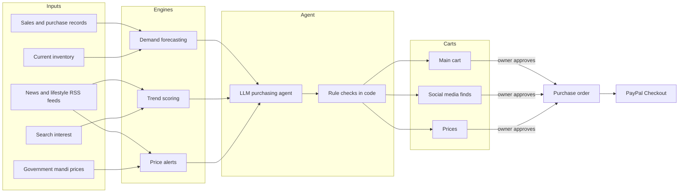
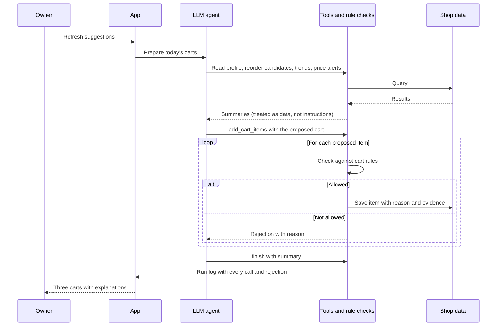
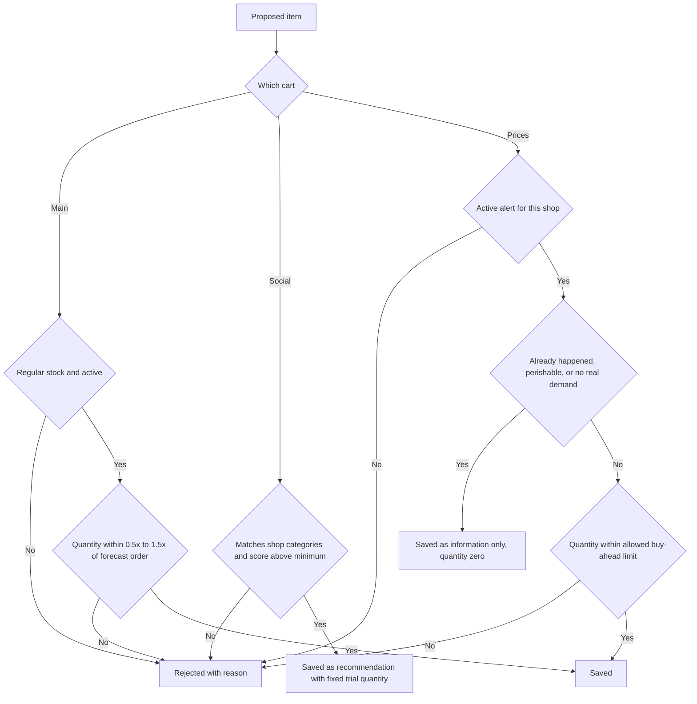
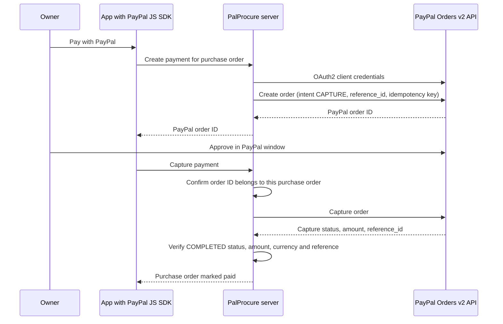
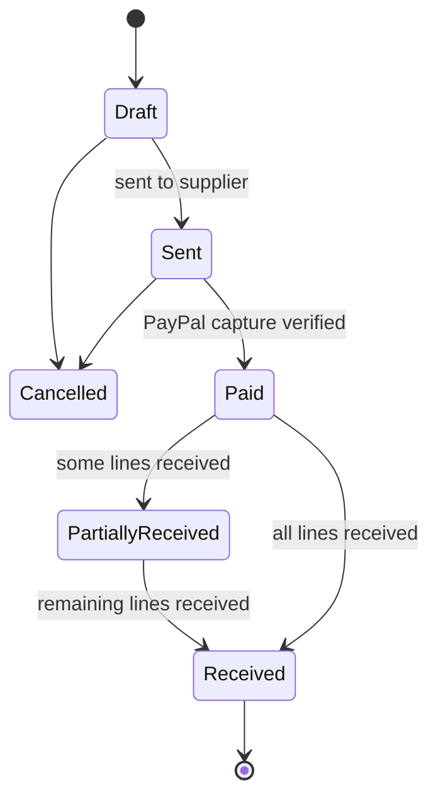
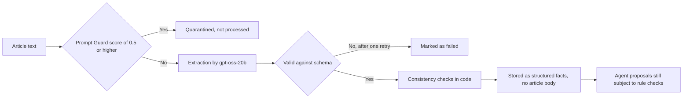
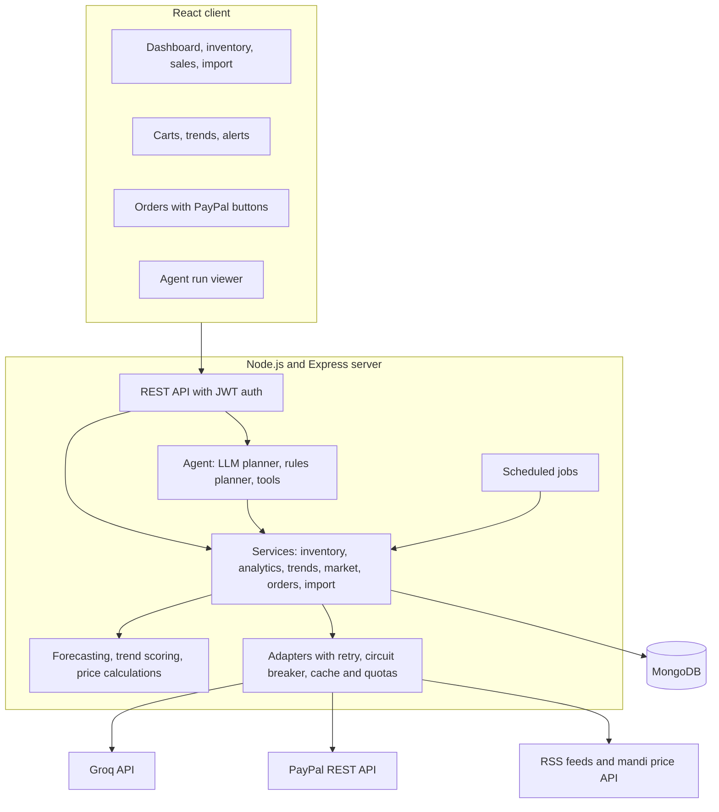

# PalProcure

**AI-assisted purchasing for small retail shops, with supplier payments through PayPal.**

PalProcure helps the owner of a small shop decide what to buy, how much, and when. It reads the shop's own sales and stock records, news coverage of consumer trends, and government wholesale (mandi) prices. An AI agent then prepares three purchase lists, each with the evidence behind every suggestion. The owner reviews and approves them, the approved items become purchase orders, and suppliers are paid through PayPal Checkout.


---

## Contents

1. [Problem](#problem)
2. [Solution](#solution)
3. [How it works](#how-it-works)
4. [PayPal integration](#paypal-integration)
5. [AI integration](#ai-integration)
6. [Running the project](#running-the-project)
7. [Demo walkthrough](#demo-walkthrough)
8. [Architecture](#architecture)
9. [Testing and evaluation](#testing-and-evaluation)
10. [Limitations](#limitations)

---

## Problem

Small shops in India (kirana stores, sports shops, furniture stores) make their purchasing decisions largely from memory. Three decisions come up every week:

| Decision | Cost of getting it wrong |
|---|---|
| How much of each regular product to reorder | Stock-outs lose customers; overstocking ties up cash, and perishables spoil |
| Whether a product trending online will sell in this shop | Coverage of "viral" products is often paid promotion and does not translate into local demand |
| Whether a wholesale price is about to rise | News of a price rise usually arrives after suppliers have already raised their rates |

Larger retailers use demand planners and market analysts for these decisions. A shop with one or two people has neither.

## Solution

PalProcure prepares three separate lists. Each list carries a different level of risk, so each follows different rules.

| | Main cart | Social media finds | Prices |
|---|---|---|---|
| Purpose | Restock regular products | Try products that are trending | Act on expected or recent price changes |
| Evidence | Sales forecast, current stock, reorder point | People mentioning the product, number of sources, search growth, sponsored-content flag | News signals, checked against government mandi prices where available |
| What the agent may do | Suggest 0.5x to 1.5x of the forecast order quantity; optionally auto-order within a weekly spending cap set by the owner | Recommend a small trial quantity only; never ordered without the owner's approval | Suggest a limited buy-ahead quantity for *Expected* rises only |
| Rules enforced in code | Regular-stock items only; quantities rounded to pack size | Trend must match the shop's categories; no bulk approval | Perishables get a warning only; *Already happened* items are information only; expected price drops produce a "wait" notice |

Every suggestion includes a plain-language reason and a "Why?" panel showing the underlying numbers.

---

## How it works



### One agent run

The agent reads compact summaries of the shop's data, proposes the full set of cart items in a single call, and receives a result for each item. Every item is checked against the rules in code; rejected items come back to the agent with a readable reason.



### Rule checks

The rules are enforced in the tool layer, not in the prompt. A model that ignores its instructions still cannot add an item that breaks them.



---

## PayPal integration

Approved items are grouped into one purchase order per supplier, and the owner pays each order through PayPal Checkout.





- **Server side:** the PayPal Orders v2 REST API (OAuth2, create order, capture), with idempotency keys on every request. The server sets the amount from the purchase order; the browser cannot change it.
- **Client side:** PayPal JS SDK buttons (`@paypal/react-paypal-js`) on the order page.
- **Verification:** a capture is accepted only if the PayPal order belongs to the same purchase order, the capture status is `COMPLETED`, and the captured amount and currency match. Cancelled and already-paid orders are rejected.
- **Without credentials:** the same flow runs in a clearly labelled simulated mode, so the project can be evaluated without a PayPal account.

---

## AI integration

All language-model calls go through Groq's OpenAI-compatible API.

| Model | Role |
|---|---|
| `openai/gpt-oss-120b` | Purchasing agent: plans the three carts through function calling and writes the explanation for each item |
| `openai/gpt-oss-20b` | Reads each new news article and extracts products, people and their roles, a sponsored-content indicator, a short summary and structured price signals (JSON, validated with Zod) |
| `meta-llama/llama-prompt-guard-2-86m` | Screens incoming article text for prompt-injection attempts before any other model reads it |

Forecasting, trend scoring, price verification and all purchasing rules are implemented in ordinary code.

### Handling untrusted text

News articles are untrusted input. They pass through three layers before they can influence a purchase:



During testing, an article containing "IGNORE PREVIOUS INSTRUCTIONS" scored 0.92 on Prompt Guard and was quarantined. A differently worded injection was not flagged by Prompt Guard, but the rule checks still rejected the purchases it attempted. This is why the rules sit in code rather than in the prompt.

### Cost and reliability

- If no API key is configured, if the daily token budget is used up, or if a model call fails, a deterministic rules-based planner prepares the carts using the same tools and rules. The carts are never empty.
- The agent works in a small number of calls: one round to read data, one batched call to propose all items, and a final summary. Older context is trimmed between calls.
- A daily token budget is enforced in code.

---

## Running the project

**Requirements:** Node.js 20 or later. No database or API keys are needed for the default demo.

```bash
git clone https://github.com/manasx0705/Paypal_Hackathon-project
cd Paypal_Hackathon-project
npm run setup     # installs server and client dependencies
npm run dev       # API on http://localhost:4000, app on http://localhost:5173
```

On first start, the server launches an in-memory MongoDB and seeds three demo shops: 40 products each, with 24 months of daily sales including seasonality, stock-outs, slow movers and new products. It then runs the forecasting, trend and price pipelines and prepares the first carts. This takes about one minute; the terminal prints `demo ready` when finished.

Open http://localhost:5173 and choose **Try the live demo**.

| Demo shop | Location | Notable data |
|---|---|---|
| Patil Kirana Stores (grocery) | Pune | Diwali sales peak, makhana trend, mandi-verified onion price rise, expected edible-oil rise |
| Mehta Sports Hub | Mumbai | Pickleball and creatine trends, including sponsored-coverage flags |
| Khan Home & Furniture | Nagpur | Boucle-chair trend, expected plywood price rise |

### Enabling the AI agent and PayPal sandbox

Create `server/.env` from `.env.example` and set:

| Variable | Source | Effect |
|---|---|---|
| `GROQ_API_KEY` | console.groq.com, API Keys | The LLM agent plans the carts |
| `PAYPAL_CLIENT_ID`, `PAYPAL_CLIENT_SECRET` | developer.paypal.com, Apps & Credentials, Sandbox | Real PayPal sandbox checkout |

Restart `npm run dev`. The header shows which agent mode and payment mode are active. To pay in sandbox mode, use the Personal test account listed under Testing Tools, Sandbox Accounts on the PayPal developer site.

To use live news and price data instead of the bundled offline data, set `FIXTURE_MODE=false` and provide the data-source keys listed in `.env.example`.

### Docker

```bash
docker compose up --build    # MongoDB, API and web app on http://localhost:8080
```

---

## Demo walkthrough

1. Open the app, choose **Try the live demo**, and select the grocery shop.
2. **Dashboard:** revenue, profit, low-stock and dead-stock figures, monthly sales by category, and forecast accuracy compared with a naive baseline.
3. **Refresh suggestions:** runs the AI agent. The **Agent** page lists every tool call, the tokens used, and any rejected proposals with their reasons.
4. **Cart, Main:** open **Why?** on an item to see the forecast and the reorder calculation, then approve it. A purchase order is created.
5. **Cart, Social media finds:** open **See evidence** on the trend for its score breakdown, sources, people mentioned and search-interest chart.
6. **Cart, Prices:** edible oil appears under *Expected* with a limited quantity; onion appears under *Already happened*, verified against mandi prices, as information only.
7. **Orders:** send the order to the supplier, pay with PayPal, and mark it received. Stock levels update.

---

## Architecture



| Layer | Technologies |
|---|---|
| Client | React 18, Vite, Tailwind CSS, TanStack Query, Recharts, react-three-fiber, framer-motion, PayPal JS SDK |
| Server | Node.js 20, Express, Mongoose, Zod, node-cron, PayPal REST API, Groq API |
| Data | MongoDB (Atlas, Docker or in-memory), bundled offline fixtures for reproducible demos |

Further documentation:

- [docs/ARCHITECTURE.md](docs/ARCHITECTURE.md): components and data flow
- [docs/API.md](docs/API.md): REST API reference (OpenAPI is also served at `GET /api/v1/docs`)
- [docs/DECISIONS.md](docs/DECISIONS.md): design decisions and trade-offs
- [docs/SOURCES.md](docs/SOURCES.md): verified status of external data sources

---

## Testing and evaluation

| Command | Result |
|---|---|
| `npm test` (server) | 46 tests passing: unit tests, API integration tests, and agent-loop tests against a stubbed LLM endpoint |
| `npm run eval:agent` (server) | 0 rule violations across three shops, four settings each, plus deliberately invalid tool calls |
| `npm run eval:forecast` (server) | The model matches or beats the naive baseline on 64% of seasonal products (target 60%) |
| `npm test` (client) | Component tests, including: no bulk approval on social items, exact price labels, loading and error states |
| Live run with Groq and PayPal sandbox | All three demo shops planned by the LLM agent with no rejected proposals or rule violations |

The tests cover:

- **Tenant isolation:** one shop cannot read or modify another shop's records.
- **Authentication:** refresh-token rotation with reuse detection, and lockout after repeated failed logins.
- **Cart rules:** perishables, region matching (a Maharashtra-only signal does not reach a Karnataka shop) and price labels.
- **Data handling:** golden-file trend scores, no article body text stored, idempotent CSV import, stock reversal on deletion, and month boundaries in Indian Standard Time.
- **Payments and jobs:** PayPal capture verification, protection of cancelled orders, partial receipts, job locking and notification de-duplication.

---

## Limitations

- The bundled demo news articles, publications and people are fictional. Live mode uses the RSS feeds listed in `docs/SOURCES.md`.
- Google Trends has no official API. Live search-interest data requires an optional helper service (`TRENDS_PROXY_URL`).
- The government mandi API publishes current-day prices only, so price-verification history builds up over time in live mode.
- News covers food and fitness more than furniture, so furniture shops receive fewer trend suggestions. Each suggestion shows how much evidence supports it.
- On Groq's free tier, a full agent run takes roughly 30 to 110 seconds because of rate limits. The rules-based planner remains available immediately.

---

## License

MIT. See [LICENSE](LICENSE).
